# Diagrama de clases (DC) de Alma Acompaña

Imagen de referencia: `Diagrama UML - Diagrama de clases.jpg`

Convenciones:
- Las clases van en `CamelCase` y los atributos en `snake_case`. En el código Java los atributos van en camelCase (por ejemplo, `nombre_usuario` es `nombreUsuario`).
- `*` = muchos; `0..1` = opcional; `1..*` = uno o más.
- `A → B` es la flecha que dibuja el diagrama de A hacia B.

## Enumeraciones

| Enum | Valores |
|---|---|
| `CategoriaEjercicio` | `REFRAN`, `SERIE`, `ASOCIACION`, `MEMORIA` |
| `CategoriaMicrocapsula` | `PREVENCION_CAIDAS`, `CUIDADO_HOGAR`, `ACTIVIDAD_FISICA`, `ALIMENTACION`, `SUENIO_DESCANSO`, `BIENESTAR_EMOCIONAL`, `RECOMENDACIONES` |
| `TamanioLetra` | `NORMAL`, `GRANDE`, `MUY_GRANDE` |
| `NivelAnimo` | `MUY_MAL`, `MAL`, `NEUTRO`, `BIEN`, `MUY_BIEN` |
| `FormatoEjercicio` | `OPCION_MULTIPLE`, `ORDENAR` |
| `NivelDificultad` | `BASICO`, `INTERMEDIO`, `AVANZADO` |
| `FrecuenciaToma` | `DIARIA`, `DIA_POR_MEDIO`, `SEMANAL` |
| `Rol` | `PERSONA_MAYOR`, `ADMINISTRADOR` |
| `EstadoNotificacion` | `PENDIENTE`, `TOMADA`, `VISTA` |

Nota del diagrama sobre `EstadoNotificacion`: **`TOMADA` = medicamento, `VISTA` = cita médica.**

## Clases

### Cuenta
| Atributo | Tipo |
|---|---|
| `id_cuenta` | Int |
| `nombre_usuario` | String |
| `contrasenia` | String |
| `rol` | Rol |
| `fecha_alta` | Date |

### Administrador
| Atributo | Tipo |
|---|---|
| `id_administrador` | int |
| `nombre` | String |
| `apellido` | String |

### PersonaMayor
| Atributo | Tipo |
|---|---|
| `id_persona_mayor` | int |
| `nombre` | String |
| `apellido` | String |
| `fecha_nacimiento` | Date |

### PreferenciaAccesibilidad
| Atributo | Tipo |
|---|---|
| `tamanio_letra` | TamanioLetra |
| `alto_contraste` | Boolean |

### RegistroAnimo
| Atributo | Tipo |
|---|---|
| `id_registro_animo` | int |
| `nivel_animo` | NivelAnimo |
| `fecha_hora` | Date |

### Microcapsula
| Atributo | Tipo |
|---|---|
| `id_microcapsula` | int |
| `titulo` | String |
| `texto` | String |
| `categoria` | CategoriaMicrocapsula |
| `imagen` | String, ruta |
| `fecha_publicacion` | Date |
| `fecha_baja` | Date |

### MicrocapsulaGuardada
| Atributo | Tipo |
|---|---|
| `fecha_guardado` | DateTime |

### Recordatorio (clase base)
| Atributo | Tipo |
|---|---|
| `id_recordatorio` | int |
| `fecha_creacion` | DateTime |

### RecordatorioMedicacion (hereda de Recordatorio)
| Atributo | Tipo |
|---|---|
| `nombre_medicamento` | String |
| `dosis` | String |
| `hora_toma` | Time |
| `frecuencia` | FrecuenciaToma |
| `fecha_inicio` | Date |
| `duracion_dias` | int |

### RecordatorioCita (hereda de Recordatorio)
| Atributo | Tipo |
|---|---|
| `titulo` | String |
| `especialidad` | String |
| `medico` | String |
| `lugar` | String |
| `fecha_hora` | DateTime |
| `indicaciones_previas` | String |

### NotificacionRecordatorio
| Atributo | Tipo |
|---|---|
| `id_notificacion_recordatorio` | int |
| `fecha_hora_programada` | DateTime |
| `estado` | EstadoNotificacion |
| `fecha_hora_toma` | DateTime |

### Ejercicio
| Atributo | Tipo |
|---|---|
| `id_ejercicio` | int |
| `categoria` | CategoriaEjercicio |
| `consigna` | String |
| `nivel_dificultad` | NivelDificultad |
| `explicacion` | String |
| `fecha_alta` | Date |
| `formato` | FormatoEjercicio |
| `texto_a_memorizar` | String |
| `fecha_baja` | Date |

### OpcionRespuesta
| Atributo | Tipo |
|---|---|
| `id_opcion_respuesta` | int |
| `texto` | String |
| `es_correcta` | Boolean |
| `imagen` | String |
| `orden_correcto` | Int |

### IntentoEjercicio
| Atributo | Tipo |
|---|---|
| `id_intento_ejercicio` | int |
| `fecha_hora` | Date |
| `acierto` | Boolean |

### ProgresoJuego
| Atributo | Tipo |
|---|---|
| `id_progreso_juego` | int |
| `nivel_actual` | NivelDificultad |
| `aciertos_consecutivos` | int |
| `errores_consecutivos` | int |
| `fecha_ultima_sesion` | Date |

## Relaciones

| # | Relación | Multiplicidad | Tipo |
|---|---|---|---|
| 1 | `Administrador` → `Cuenta` | 1 a 1 | Asociación |
| 2 | `PersonaMayor` → `Cuenta` | 1 a 1 | Asociación |
| 3 | `PersonaMayor` → `PreferenciaAccesibilidad` | 1 a 1 | **Composición** (el rombo está del lado de `PersonaMayor`) |
| 4 | `MicrocapsulaGuardada` → `PersonaMayor` | `*` a 1 | Asociación |
| 5 | `MicrocapsulaGuardada` → `Microcapsula` | `*` a 1 | Asociación |
| 6 | `RegistroAnimo` → `PersonaMayor` | `*` a 1 | Asociación |
| 7 | `Recordatorio` → `PersonaMayor` | `*` a 1 | Asociación |
| 8 | `NotificacionRecordatorio` → `Recordatorio` | `*` a 1 | Asociación |
| 9 | `RecordatorioMedicacion` y `RecordatorioCita` → `Recordatorio` | n/a | **Herencia** (generalización) |
| 10 | `ProgresoJuego` → `PersonaMayor` | `0..1` a 1 | Asociación |
| 11 | `IntentoEjercicio` → `PersonaMayor` | `*` a 1 | Asociación |
| 12 | `IntentoEjercicio` → `Ejercicio` | `*` a `0..1` | Asociación |
| 13 | `ProgresoJuego` → `Ejercicio` | `*` a `0..1` | Asociación (último ejercicio jugado) |
| 14 | `Ejercicio` → `OpcionRespuesta` | 1 a `1..*` | **Composición** (el rombo está del lado de `Ejercicio`) |

## Diagrama (Mermaid)

Se dibuja solo en GitHub y en VS Code con la vista previa de Markdown. Es una versión simplificada (sin atributos) de la imagen de referencia.

```mermaid
classDiagram
    direction LR

    Administrador "1" --> "1" Cuenta
    PersonaMayor "1" --> "1" Cuenta
    PersonaMayor "1" *-- "1" PreferenciaAccesibilidad
    MicrocapsulaGuardada "*" --> "1" PersonaMayor
    MicrocapsulaGuardada "*" --> "1" Microcapsula
    RegistroAnimo "*" --> "1" PersonaMayor
    Recordatorio "*" --> "1" PersonaMayor
    NotificacionRecordatorio "*" --> "1" Recordatorio
    Recordatorio <|-- RecordatorioMedicacion
    Recordatorio <|-- RecordatorioCita
    ProgresoJuego "0..1" --> "1" PersonaMayor
    IntentoEjercicio "*" --> "1" PersonaMayor
    IntentoEjercicio "*" --> "0..1" Ejercicio
    ProgresoJuego "*" --> "0..1" Ejercicio
    Ejercicio "1" *-- "1..*" OpcionRespuesta
```

