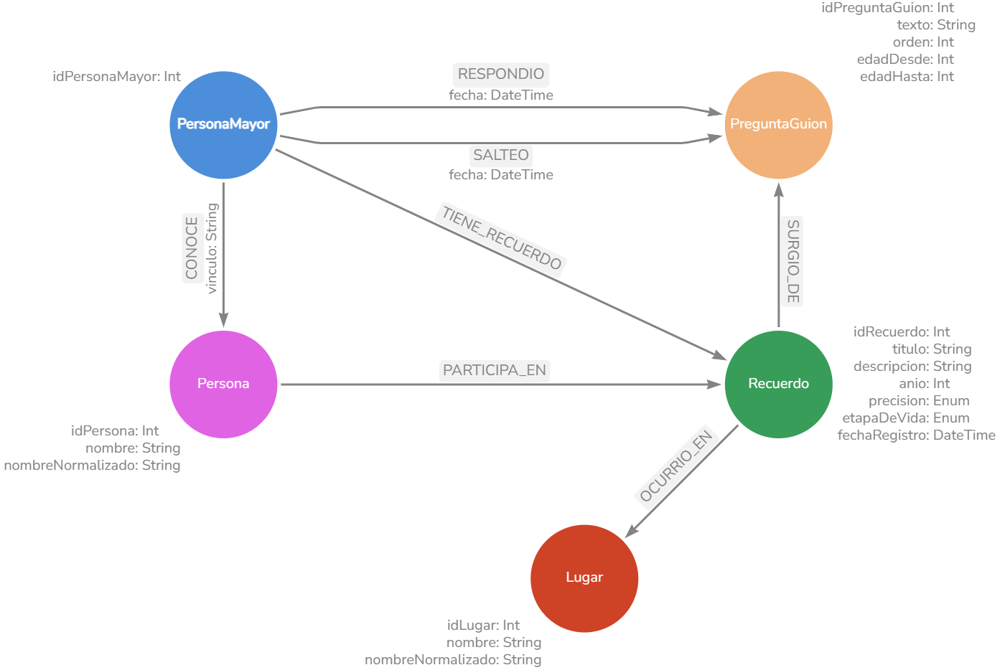

# Modelo de grafo · Historia de vida

Resumen del modelo de grafo de conocimiento de Alma Acompaña (Neo4j). El documento completo y su validación están en el informe de la PPS ("Modelo de Grafo de Conocimiento"). Este archivo existe para que quien clone el repositorio entienda el modelo sin tener el PDF.

## Para qué sirve

Neo4j guarda **solo** la historia de vida de la persona mayor, que es la fuente de tres funcionalidades:

- **CU-03** Responder preguntas guiadas: el guion de preguntas y el progreso de cada persona.
- **CU-04** Línea de tiempo: los recuerdos ordenados cronológicamente.
- **CU-02** Chat: recuerdos relacionados con lo que la persona menciona. Como el historial del chat no se guarda, el grafo es la única memoria de largo plazo de Alma.

## Qué va en cada base

| Neo4j (grafo) | PostgreSQL (relacional) |
|---|---|
| Recuerdos, personas mencionadas, lugares y referencias temporales | Perfiles, autenticación y fecha de nacimiento |
| Guion de preguntas y progreso de cada persona | Ánimo, recordatorios, ejercicios, juegos, microcápsulas |

El único dato compartido entre las dos bases es el **identificador de la persona mayor**. El nodo `PersonaMayor` no duplica datos de perfil. Cuando la persona dice una edad ("cuando tenía 15 años"), el back calcula el año con la fecha de nacimiento (de PostgreSQL) y guarda el resultado ya calculado en el recuerdo.

## Nodos

| Nodo | Propiedades | Notas |
|---|---|---|
| `PersonaMayor` | `idPersonaMayor` | Mismo id que en PostgreSQL. Único. |
| `PreguntaGuion` | `idPreguntaGuion`, `texto`, `orden`, `edadDesde?`, `edadHasta?`, `repreguntas` | Único nodo compartido por todas las personas. `orden` es único. Las preguntas sin época no tienen franja de edad. `repreguntas` es la lista (hasta 3 elementos, puede estar vacía) de datos por los que se puede repreguntar sobre esa pregunta, en orden de prioridad: `ANIO`, `LUGARES`, `PERSONAS`. |
| `Recuerdo` | `idRecuerdo`, `titulo`, `descripcion`, `anio?`, `precision?`, `etapaDeVida?`, `fechaRegistro`, `intentosAnio`, `intentosLugares`, `intentosPersonas` | Si tiene `anio`, tiene `precision`. Los tres contadores cuentan cuántas veces se preguntó por cada dato (valen 0 si no existen y nunca pasan de 2). |
| `Persona` | `idPersona`, `nombre?`, `nombreNormalizado?` | El nombre puede faltar si solo se menciona el vínculo ("mi tío"). |
| `Lugar` | `idLugar`, `nombre`, `nombreNormalizado` | |

`?` indica propiedad opcional. **Identificadores:** `PersonaMayor.idPersonaMayor` es un `Long` (el mismo id que la persona mayor tiene en PostgreSQL); `PreguntaGuion.idPreguntaGuion` es un `Integer` fijo, definido en el archivo del guion; `Recuerdo`, `Persona` y `Lugar` llevan un UUID como `String`, generado por la aplicación (Neo4j no tiene un contador seguro: su número interno se puede reutilizar tras un borrado). El detalle está en `docs/contrato-grafo.md`, secciones 2 y 4.1.

## Relaciones

| Relación | Origen → Destino | Propiedades | Significado |
|---|---|---|---|
| `RESPONDIO` | `PersonaMayor` → `PreguntaGuion` | `fecha` | Respondió la pregunta |
| `SALTEO` | `PersonaMayor` → `PreguntaGuion` | `fecha` | Salteó la pregunta |
| `TIENE_RECUERDO` | `PersonaMayor` → `Recuerdo` | — | El recuerdo es de la persona |
| `CONOCE` | `PersonaMayor` → `Persona` | `vinculo` | Vínculo con la persona mencionada (hermana, amigo, jefe…) |
| `SURGIO_DE` | `Recuerdo` → `PreguntaGuion` | — | La pregunta que originó el recuerdo |
| `PARTICIPA_EN` | `Persona` → `Recuerdo` | — | La persona participó del recuerdo |
| `OCURRIO_EN` | `Recuerdo` → `Lugar` | — | Dónde ocurrió |

El vínculo es propiedad de `CONOCE` y no de `Persona`, porque describe cómo se relacionan las dos personas, no una característica de la mencionada.

## Valores enumerados

Neo4j no tiene enumerados: se guardan como texto y la aplicación controla los valores.

**`Recuerdo.precision`:** `EXACTA` (la persona dijo el año), `APROXIMADA` (la persona dijo un año aproximado, en cifras: por ejemplo, "por 1970"), `CALCULADA_POR_EDAD` (a partir de la edad mencionada y la fecha de nacimiento), `ESTIMADA` (a partir de la franja de edad de la pregunta). Una década escrita ("los años 70") no se convierte en año: el extractor solo acepta un año que aparece escrito en cifras en la respuesta, así que ese recuerdo queda `ESTIMADA` con la franja de la pregunta.

**`Recuerdo.etapaDeVida`:** `INFANCIA` (0 a 11), `ADOLESCENCIA` (12 a 17), `JUVENTUD` (18 a 29), `ADULTEZ` (30 a 59), `VEJEZ` (60 o más). Se deriva de la edad que la persona tenía en el año del recuerdo.

## Reglas de integridad

1. **Pertenencia:** todo `Recuerdo`, `Persona` y `Lugar` pertenece a una sola persona mayor. No se comparten entre usuarios.
2. **Origen:** todo `Recuerdo` tiene exactamente una relación `SURGIO_DE`.
3. **Estado de la pregunta:** una persona no puede tener `RESPONDIO` y `SALTEO` hacia la misma pregunta.
4. **Progreso:** la pregunta pendiente es la de menor `orden` sin `RESPONDIO` ni `SALTEO`. No hay un puntero de progreso aparte.
5. **Sin duplicados:** dentro del grafo de una persona no hay dos `Persona` ni dos `Lugar` con el mismo `nombreNormalizado`.
6. **Coherencia temporal:** todo recuerdo con `anio` tiene `precision`. Si la respuesta no aporta datos temporales, el año se estima con la franja de la pregunta (`ESTIMADA`). Si la pregunta no tiene franja, el recuerdo queda sin año y la línea de tiempo lo muestra aparte.
7. **Repreguntas:** las preguntas de seguimiento no crean nodos `PreguntaGuion` ni cambian el progreso. Sus respuestas completan el `Recuerdo` de origen. Cada dato (año, lugares, personas) de cada recuerdo se pregunta como máximo 2 veces en total, contadas con `intentosAnio`, `intentosLugares` e `intentosPersonas`; responder y saltear cuentan igual.
8. **Baja de usuario:** al eliminar a la persona se borran su nodo `PersonaMayor` y todos sus `Recuerdo`, `Persona` y `Lugar`. Las `PreguntaGuion` no se tocan.
9. **Guion compartido:** las `PreguntaGuion` se cargan al arrancar la aplicación, con un proceso de carga inicial que solo crea las preguntas que no existen (por `idPreguntaGuion`) y no modifica las que ya están: así, un cambio hecho en el grafo no se pisa en un reinicio.

Las restricciones de unicidad (ver `restricciones.cypher`) cubren los identificadores y `PreguntaGuion.orden`. El resto de las reglas las valida la aplicación.

La aplicación crea esas restricciones al arrancar con una **copia** de este archivo: `backend/alma/src/main/resources/historia/restricciones.cypher` (igual, salvo una línea de comentario que avisa que es una copia). **Hay que mantenerlas sincronizadas:** la prueba `RestriccionesCypherTest` falla si dejan de ser iguales.

**Aislamiento:** toda consulta sobre `Recuerdo`, `Persona` o `Lugar` tiene que partir del nodo `PersonaMayor`. Sin ese ancla se mezclarían datos de distintas personas.

## Consultas que el modelo responde

Las 17 consultas (P1 a P17) están en `consultas.cypher`.

| Caso de uso | Consultas |
|---|---|
| CU-03 guion y progreso | P1 próxima pregunta · P2 ¿quedan pendientes? · P3 última respondida o salteada · P4 estado de todas · P5 recuerdos de una pregunta |
| CU-03 construcción del grafo | P6 ¿existe la persona? · P7 ¿existe una persona con este vínculo? · P8 ¿existe el lugar? · P9 vínculo con una persona |
| CU-04 línea de tiempo | P10 recuerdos en orden cronológico (los sin año al final) · P11 ¿tiene recuerdos? · P12 detalle de un recuerdo |
| CU-02 chat | P13 recuerdos de una persona · P14 de un lugar · P15 de una etapa · P16 personas y vínculos · P17 lugares |

## Cargar el ejemplo para verlo

Los scripts de esta carpeta son los de la validación del modelo, con datos de ejemplo de dos personas. Orden: `restricciones.cypher`, `datos-de-ejemplo.cypher` y después las consultas que se quieran probar.

> **Cargalos en un Neo4j de pruebas, no en el de la aplicación.** El ejemplo usa ids numéricos y crea `PreguntaGuion` con `orden` único, lo que chocaría con el guion real que carga la aplicación. Para ver el resultado: Neo4j Browser (`http://localhost:7474`) y la consulta `MATCH (n) RETURN n`.
